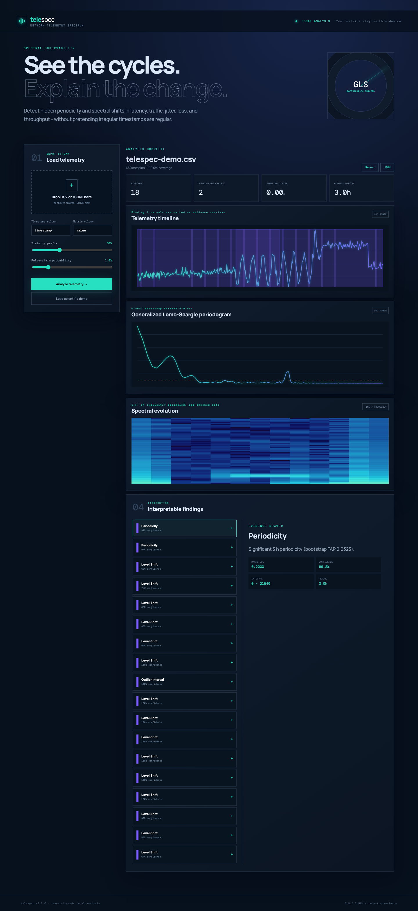

# telespec

[](https://github.com/akshajbachu/telespec/actions/workflows/ci.yml)
[](https://pypi.org/project/telespec/)
[](https://www.python.org/)
[](https://akshajbachu.github.io/telespec/)
[](LICENSE)
[](https://doi.org/10.5281/zenodo.23552711)

Explainable spectral analysis and anomaly detection for irregular network telemetry.

Unlike interpolate-then-FFT pipelines, telespec applies a floating-mean generalized
Lomb-Scargle periodogram directly to observed timestamps and calibrates significant
peaks using a permutation bootstrap. It turns latency, throughput, jitter, loss, or
request-count series into plain-language, evidence-backed findings.

## Install

```bash
pip install "telespec[ui]"
```

For development:

```bash
git clone https://github.com/akshajbachu/telespec.git
cd telespec
uv sync --extra dev
```

## Try it

```bash
telespec demo -o demo.csv
telespec analyze-file demo.csv --column latency
telespec view
```

The dashboard is private and local at `http://127.0.0.1:8765`.



## Python

```python
from telespec import analyze
from telespec.io import read_csv

telemetry = read_csv("metrics.csv", timestamp="timestamp", value="latency_ms")
result = analyze(telemetry, bootstrap_iterations=200)
for finding in result.findings:
    print(finding.summary)
```

## Reproducible validation

`uv run python benchmarks/run_all.py --quick` regenerates `benchmarks/results/results.json`
and every SVG under `benchmarks/results/`. The full run evaluates frequency recovery
under missing/jittered samples, false-alarm calibration, synthetic anomaly detection,
and selected expert-labeled NAB series. Metrics are generated from code; no numbers are
handwritten.

<!-- BENCHMARK_RESULTS_START -->
Latest `full` reproducible run:

- At 60% missing observations, median frequency error was 0.57% for GLS versus 1.27% for interpolate+FFT.
- Synthetic level shift F1: 0.644 (telespec), 0.000 (3-sigma), 0.678 (EWMA).
- Synthetic variance burst F1: 0.678 (telespec), 1.000 (3-sigma), 1.000 (EWMA).
- Synthetic spikes F1: 0.678 (telespec), 0.833 (3-sigma), 0.833 (EWMA).
- Synthetic periodicity F1: 0.667 (telespec), 0.919 (3-sigma), 0.919 (EWMA).
- NAB macro F1 across 5 selected series: 0.187.
<!-- BENCHMARK_RESULTS_END -->

## Design promises

- Irregular sampling is measured and surfaced.
- Interpolation is explicit and never used for the primary periodogram.
- Every peak has a global bootstrap false-alarm probability.
- Every anomaly is an interval with evidence and a plain-English reason.
- Limitations and benchmark losses are reported alongside wins.

## Documentation

Full documentation is at
[akshajbachu.github.io/telespec](https://akshajbachu.github.io/telespec/),
including the [methodology](docs/methodology.md), [validation protocol](docs/validation.md),
and [release guide](docs/release.md).

## Contributing

Contributions are welcome. See [CONTRIBUTING.md](CONTRIBUTING.md) for
development setup and checks, and the [Code of Conduct](CODE_OF_CONDUCT.md).
Report security issues privately as described in [SECURITY.md](SECURITY.md).
Release history is in [CHANGELOG.md](CHANGELOG.md).

## Citation

If you use telespec in research, please cite it. GitHub's **Cite this
repository** button (from [`CITATION.cff`](CITATION.cff)) provides APA and
BibTeX entries. The concept DOI
[10.5281/zenodo.23552711](https://doi.org/10.5281/zenodo.23552711) always resolves to the latest
version; each release also has its own version DOI on Zenodo.

## License

telespec is released under the [MIT License](LICENSE).
